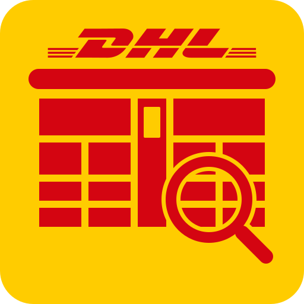

# DHL Packstation Monitor

See the free S, M, L and XL compartments of German DHL Packstations in Home Assistant.
Monitor several stations with a bundled dashboard card, count history and sensors
for automations. Find stations by address or postal code; no DHL account or API key
is required.

  <picture>
    <source media="(prefers-color-scheme: dark)" srcset="docs/images/tiles-dark.png">
    <source media="(prefers-color-scheme: light)" srcset="docs/images/tiles.png">
    
  </picture>

This is an independent community integration, not an official DHL product.

> [!NOTE]
> **AI-assisted development:** AI tools helped write the code, tests and documentation.

## Requirements

- Home Assistant **2026.9.0 or later**. Tested with **2026.9.0** and **2026.11.2**.
- HTTPS access to `www.dhl.de`.
- A Packstation listed by DHL. Some stations provide no live compartment data.

## Installation

Use the repository button above to open this integration in Home Assistant
Marketplace, download it, and restart Home Assistant. Continue with [setup](#setup).

HACS (Home Assistant <2026.11)

1. In HACS, open **Custom repositories**.
2. Add `https://github.com/jonalbr/ha-dhl-packstation` with category **Integration**.
3. Download **DHL Packstation Monitor** and restart Home Assistant.
4. Continue with [setup](#setup).

For updates, update through HACS and restart Home Assistant.

## Setup

1. Open **Settings > Devices & services > Add integration > DHL Packstation Monitor**.
2. Search using one line, for example `10117` or `Georgenstraße 31, 10117 Berlin`
   (street and house number, postal code and city). Alternatively, enter a station's
   postal code and number.
3. Select the stations and check their addresses in the preview. Counts shown as
   `—` are unknown or old. A `⚠` means the location could not be verified: retry or
   deselect it.
4. Optionally select **Enter compartment totals now** to enter the maximum S/M/L/XL
   counts for each selected station in turn. Leave it off to finish immediately.
   Unknown totals can stay empty; you can add or change them later under **Edit station**.
5. Confirm. Each station becomes one device under the central integration entry.

Search selects **Home** when valid home coordinates exist.

Use **Add station** on that entry to add further stations individually. Existing stations
are excluded from search results. **Edit station** changes the displayed name and
rechecks the same DHL identifier; use Add station for a different location. Renaming
does not change entity identities. Device names explicitly overridden in Home Assistant
remain under your control.

Setup and **Add station** offer four optional compartment totals for S/M/L/XL.
You can also enter them later under **Edit station > Compartment totals**.
DHL supplies no totals per size. You can count compartments on site or from a
photo, then enter or change the numbers here at any time. Leave unknown sizes empty;
0 means the station has no compartments of that size. Clearing a field removes its
saved value. These numbers affect only the optional
capacity tile and never replace DHL measurements or change availability checks.

Removing a station stops its polling and removes its entities. It does not remove other
stations. The central entry can remain empty so you can add stations again later.

## Entities

Every station has nine entities:

| Entity | Meaning |
| --- | --- |
| Free S / M / L / XL compartments | Four exact nonnegative counts reported by DHL |
| Free compartments total | Sum, available only when all four sizes are known |
| DHL last updated | DHL's last valid source timestamp, retained after a failed request |
| Last poll attempt | When Home Assistant last attempted to fetch this station |
| Last successful poll | When Home Assistant last received and parsed a response successfully |
| Problem | Diagnostic for failed, missing, stale or incomplete data |

Zero means no free compartment of that size.
A missing size affects that size and the total; valid sizes remain usable if fresh.
Counts support Home Assistant history and measurement statistics.

## Options and updates

Global options apply to every station:

| Option | Default | Range |
| --- | --- | --- |
| Polling interval | 15 minutes | 5–60 whole minutes |
| Maximum source age | 75 minutes | 30–1440 whole minutes, at least the polling interval |

The source timestamp is DHL's observation time, not the time of our HTTP request.
The recommended 75-minute source age accommodates occasional hourly source updates
plus the 15-minute polling interval.
Leave either field empty to follow its recommendation.
Counts expire at their configured age even between requests. Missing timestamps,
timestamps without a timezone, and timestamps more than five minutes in the future
make counts unavailable.

Requests share a client and run sequentially. HTTP 429 pauses requests for at least
15 minutes and honors a longer `Retry-After`, in seconds or HTTP-date form. Other
failures retry on the normal polling schedule. Changing settings reloads the entry once.
One station's failure does not prevent the others from loading.

## Dashboard

### DHL Packstation card

The bundled **DHL Packstation** card uses Home Assistant's native Tile appearance.
Choose a Packstation device and display free counts by size, free total with DHL's
station capacity, or free counts with manual capacities by size.

Edit a dashboard, choose **Add card > By card**, and search for **DHL Packstation**.
Select the station and one of the three display modes.

Tap the card to open the station's device page. Tap its icon to open **Free
compartments total**, including its history.

For YAML configuration, see [card.yaml](examples/card.yaml). Its `display_mode` is
`free` (default), `total`, or `capacities`.

Unknown or expired counts appear as `—`. The station-wide capacity comes from DHL;
per-size capacities are optional manual values. A capacity smaller than the free
count appears as `—`. Manual capacities remain visible when live counts expire.

For a notification, use the desired size sensor in a Home Assistant automation and
check that its state is available. Notifications and parcel-size preferences remain
in your automations; the integration creates no custom actions or triggers.

## Limits and privacy

This uses the **DHL website's undocumented service**. Fields, access restrictions and
URLs can change.

Search text or selected home coordinates are sent to DHL and exist only in the active
setup dialog. Saved settings contain selected public stations, polling options and any
manual display capacities, not the original search address or home coordinates.
DHL sees the requesting IP address. No credentials, personal Postnummer, parcel number,
analytics service or external proxy is used. Downloadable diagnostics omit addresses,
search text and raw vendor responses. Public station identifiers remain in diagnostics.

If counts are unavailable, inspect the data timestamp and diagnostic reason. For a
missing station, verify its postal code in DHL's location finder. For request limits,
wait; repeatedly restarting setup does not improve DHL's availability.

## Removal

Remove affected dashboard cards and automations, then delete the integration entry
under Devices & services. Uninstall its repository in the Marketplace and restart
Home Assistant. Manual installations can remove the component folder after deleting
the entry, then restart. Home Assistant manages previously recorded history separately.

## License
[MIT](LICENSE). This is an independent community integration, not an official DHL product.
