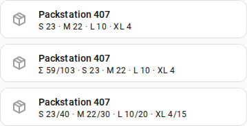

# DHL Packstation Monitor


> [!NOTE]
> **AI-assisted development:** AI tools helped write the code, tests and documentation.

See the free S, M, L and XL compartments of German DHL Packstations in Home Assistant.
Find stations by address or postal code, review their locations, and add several at once.
No DHL account or API key is required.

This is an independent community integration, not an official DHL product.

## Requirements

- Tested with Home Assistant **2026.11.1** (others may work as well).
- HTTPS access to `www.dhl.de`.
- A Packstation listed by DHL. Some stations provide no live compartment data.

## Installation

[](https://my.home-assistant.io/redirect/marketplace_repository/?owner=jonalbr&repository=ha-dhl-packstation&category=integration)

<details>
<summary>HACS (Home Assistant <2026.11)</summary>

1. In HACS, open **Custom repositories**.
2. Add `https://github.com/jonalbr/ha-dhl-packstation` with category **Integration**.
3. Download **DHL Packstation Monitor** and restart Home Assistant.
4. Continue with [setup](#setup).

For updates, update through HACS and restart Home Assistant.

</details>

## Setup

1. Open **Settings > Devices & services > Add integration > DHL Packstation Monitor**.
2. Search an address or postal code, or enter a station's postal code and number.
3. Select the stations and check their addresses in the preview. Counts shown as
   `—` are unknown or old. A `⚠` means the location could not be verified: retry or
   deselect it.
4. Confirm. Each station becomes one device under the central integration entry.

Search selects **Home** when valid home coordinates exist.
Home Assistant stores coordinates, not a street address. Click **X** to clear the
selection and enter any other address or postal code. No home location is selected
when coordinates are missing. DHL receives the chosen location only after submission.

Use **Add station** on that entry to add further stations individually. Existing stations
are excluded from search results. **Edit station** changes the displayed name and
rechecks the same DHL identifier; use Add station for a different location. Renaming
does not change entity identities. Device names explicitly overridden in Home Assistant
remain under your control.

**Edit station > Compartment totals** contains four optional fields for S/M/L/XL.
DHL supplies no totals per size. You can count compartments on site or from a clear
photo, then enter or change the numbers here at any time. Leave unknown sizes empty;
clearing a field removes its saved value. These numbers affect only the optional
capacity tile and never replace DHL measurements or change availability checks.

Removing a station stops its polling and removes its entities. It does not remove other
stations. The central entry can remain empty so you can add stations again later.

## Entities

Every station has seven entities:

| Entity | Meaning |
| --- | --- |
| Free S / M / L / XL compartments | Four exact nonnegative counts reported by DHL |
| Free compartments total | Sum, available only when all four sizes are known |
| DHL data timestamp | Last valid source timestamp, including after a failed request |
| Data problem | Diagnostic for failed, missing, stale or incomplete data |

Zero means no free compartment of that size. `Unavailable` does not mean zero.
A missing size affects that size and the total; valid sizes remain usable if fresh.
Counts support Home Assistant history and measurement statistics, not cumulative totals.

The diagnostic's `reason` attribute distinguishes `cannot_connect`, `station_not_found`,
`invalid_response`, `rate_limited`, `missing_data`, `missing_timestamp`, `future_timestamp`,
`stale_data` and `missing_compartments`. Device entities also expose the public station
identifier, number, postal code and address.

## Options and updates

Global options apply to every station:

| Option | Default | Range |
| --- | --- | --- |
| Polling interval | 15 minutes | 5–60 whole minutes |
| Maximum source age | 60 minutes | 30–1440 whole minutes, at least the polling interval |

The source timestamp is DHL's observation time, not the time of our HTTP request.
Counts expire at their configured age even between requests. Missing timestamps,
timestamps without a timezone, and timestamps more than five minutes in the future
make counts unavailable. A valid old timestamp remains visible for troubleshooting.

Requests share a client and run sequentially. HTTP 429 pauses requests for at least
15 minutes and honors a longer `Retry-After`, in seconds or HTTP-date form. Other
failures retry on the normal polling schedule. Changing settings reloads the entry once.
One station's failure does not prevent the others from loading.

## Compact tiles

Three native Tile examples use these attributes:

| Variant | Attribute | Example | File |
| --- | --- | --- | --- |
| Free by size | `compartment_summary` | `S 3 · M 0 · L 2 · XL 1` | [tile.yaml](examples/tile.yaml) |
| Free total / DHL capacity, plus sizes | `compartment_total_summary` | `Σ 6/12 · S 3 · M 0 · L 2 · XL 1` | [tile-total.yaml](examples/tile-total.yaml) |
| Free / manual capacity by size | `compartment_capacity_summary` | `S 3/4 · M 0/0 · L 2/3 · XL 1/5` | [tile-capacities.yaml](examples/tile-capacities.yaml) |

The total sensor exposes these attributes. The diagnostic exposes them even when counts
are unavailable: Home Assistant removes extra attributes from unavailable entities.
Use this diagnostic as the native Tile's entity; no custom frontend is installed.
Replace the example entity ID with your station's actual data-problem diagnostic:

```yaml
type: tile
entity: binary_sensor.replace_with_your_station_data_problem
name: Packstation 407
icon: mdi:package-variant-closed
color: amber
state_content: compartment_summary
tap_action:
  action: more-info
```

Change `state_content` to choose another variant. Unknown sizes appear as `—`; stale or
failed data never populate the summary with old counts. Tapping opens the standard
Home Assistant diagnostic details. Open the individual size or total sensors for history.

The station-wide denominator comes from DHL when present; it is not a sum of your
manual entries. A denominator smaller than the current free count appears as `—`.
The `display_capacity_issues` attribute identifies inconsistent manual entries without
raising a data problem. Manual capacities describe the physical locker and remain
visible when live counts expire. Give long summaries enough dashboard width.



For a notification, use the desired size sensor in a Home Assistant automation and
check that its state is available. Notifications and parcel-size preferences remain
in your automations; the integration creates no custom actions or triggers.

## Limits and privacy

This uses the **DHL website's undocumented service**. Fields, access restrictions and
URLs can change. Counts can be delayed and do not reserve a compartment or guarantee
availability when you arrive. This integration cannot open lockers, track parcels or
provide utilization forecasts.

Search text or selected home coordinates are sent to DHL and exist only in the active
setup dialog. Saved settings contain selected public stations, polling options and any
manual display capacities, not the original search address or home coordinates.
DHL sees the requesting IP address. No credentials, personal Postnummer, parcel number,
analytics service or external proxy is used. Downloadable diagnostics omit addresses,
search text and raw vendor responses. Public station identifiers remain in diagnostics.

If counts are unavailable, inspect the data timestamp and diagnostic reason. For a
missing station, verify its postal code in DHL's location finder. For request limits,
wait; repeatedly restarting setup does not improve DHL's availability.

## Removal

Remove affected dashboard cards and automations, then delete the integration entry
under Devices & services. Uninstall its repository in the Marketplace and restart
Home Assistant. Manual installations can remove the component folder after deleting
the entry, then restart. Home Assistant manages previously recorded history separately.

## Development

See [development](DEVELOPMENT.md), [release procedure](RELEASING.md) and the
[internal quality assessment](docs/quality-scale.md). AI tools assisted with code,
tests and documentation. The implementation follows current Home Assistant interfaces
and the development practices used in Tado Overlay Metadata.

## License
[MIT](LICENSE). This is an independent community integration, not an official DHL product.
